# Wireframes: estructura de las páginas

Informe, punto 5.b. Son diagramas lineales, sin color, para discutir dónde va cada
elemento y para qué sirve, no la estética. Todas las páginas comparten el encabezado,
el menú principal y el pie de la plantilla base; lo que cambia es el contenido.

Corregido después de la exposición. Se sacó lo que no tenía sentido:

- **Pie**: se sacaron "Accesibilidad" y "Ayuda". La accesibilidad es una cualidad de
  todo el sitio, no una sección, y la ayuda repetía las preguntas frecuentes.
- **Menú principal**: "Institucional" pasa al pie, porque no es una tarea del usuario.
- **Portada**: "Fecha de ida y de vuelta" pasa a "Salida desde / hasta", porque no hay
  vuelos de ida y vuelta. Las promociones son por aerolínea, no por ruta.
- **Resultados**: se sacó "Directo", porque no existen las escalas.
- **Detalle del vuelo**: la caja de reserva ya no repite el paso siguiente (cantidad,
  código, descuento y total), y se sacó "Imprimir detalle": lo que se imprime es el
  comprobante.
- **Reserva**: los pasos se llaman como en el sitio (1 Elegir el vuelo, 2 Asientos y
  promoción, 3 Pago); antes el pago aparecía dentro del paso 2.
- **Mis reservas**: "Cancelar" ya no está en la tabla, sino en el detalle de la reserva.
- **Menús laterales**: se sacó "Cerrar sesión", que ya está en "Mi cuenta ▾".
- **Panel del CEO**: "Duplicar" va en cada vuelo, y el gráfico es una tabla con barras.
- **Contacto**: se sacó el teléfono inventado.
- **Registro**: un solo campo "Nombre y apellido", como el modelo de datos (nombreUsuario).

Las imágenes para el informe están en [`png/`](png/). Las capturas del sitio real
están en [`docs/capturas/`](../../capturas/).

## Figura 2. Plantilla base

```mermaid
%%{init: {'theme': 'neutral'}}%%
flowchart TB
    url["aeroeb.com.ar/…"]
    salto["Saltar al contenido principal · primer elemento enfocable"]
    subgraph enc["Encabezado"]
        direction LR
        logo["LOGO AEROEB<br/>enlace a la portada"] ~~~ buscador["Buscar en el sitio… · Buscar"] ~~~ cuenta["Mi cuenta ▾"]
    end
    subgraph menu["Menú principal · ● sección activa"]
        direction LR
        m0["Inicio"] ~~~ m1["● Vuelos"] ~~~ m2["Aerolíneas"] ~~~ m3["Novedades"] ~~~ m4["Contacto"]
    end
    migas["Inicio › Sección › Página"]
    subgraph cont["Contenido"]
        direction LR
        aside["aside<br/>filtros o menú lateral<br/>según la página"] ~~~ main["main id=contenido<br/>h1 · título de la página<br/>contenido principal<br/>paginación cuando corresponde"]
    end
    subgraph pie["Pie de página"]
        direction LR
        explorar["Explorar<br/>Buscar vuelos · Aerolíneas · Novedades<br/>Buscador del sitio · Mapa del sitio"] ~~~ institucional["Institucional<br/>Quiénes somos · Preguntas frecuentes<br/>Términos y condiciones · Contacto"] ~~~ legal["© 2026 AeroEB<br/>Última actualización: dd/mm/aaaa"]
    end
    url ~~~ salto ~~~ enc ~~~ menu ~~~ migas ~~~ cont ~~~ pie
```

Imagen: [`png/wf-01-plantilla.png`](png/wf-01-plantilla.png)

## Figura 3. Portada

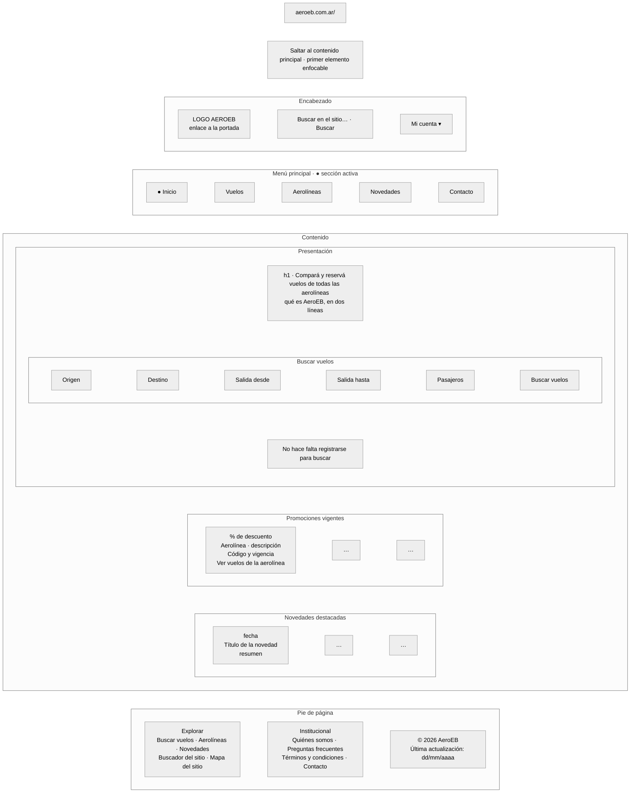

Imagen: [`png/wf-02-portada.png`](png/wf-02-portada.png)

## Figura 4. Resultados de búsqueda

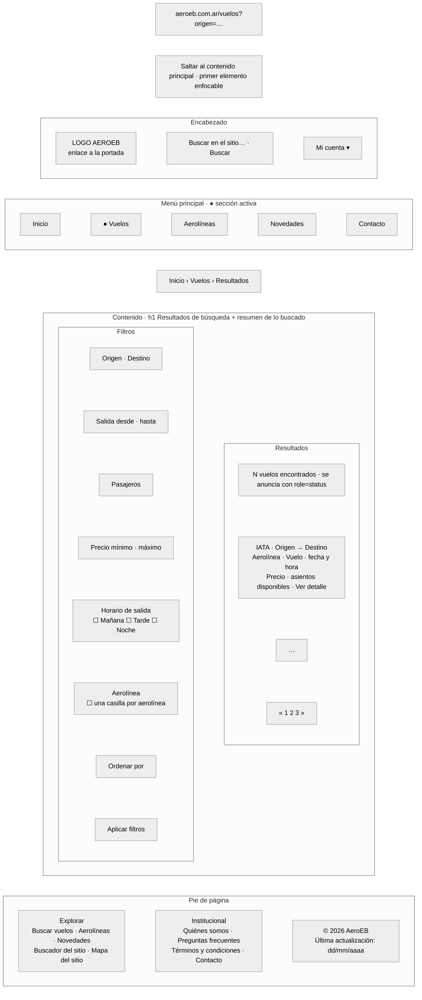

Imagen: [`png/wf-03-resultados.png`](png/wf-03-resultados.png)

## Figura 5. Detalle del vuelo

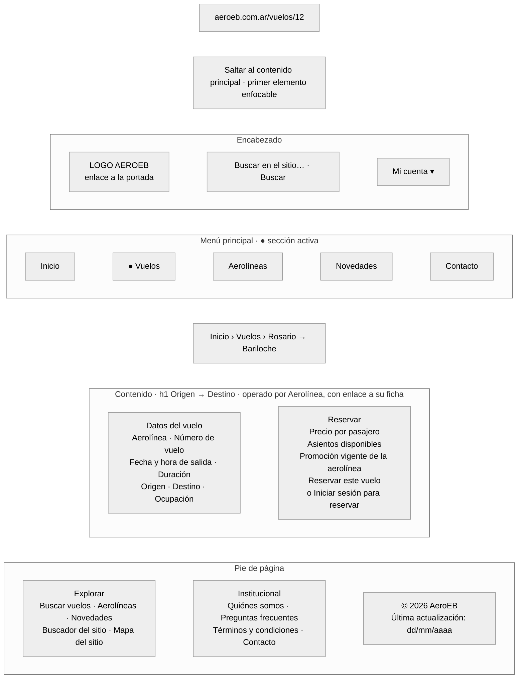

Imagen: [`png/wf-04-detalle-vuelo.png`](png/wf-04-detalle-vuelo.png)

## Figura 6. Registro

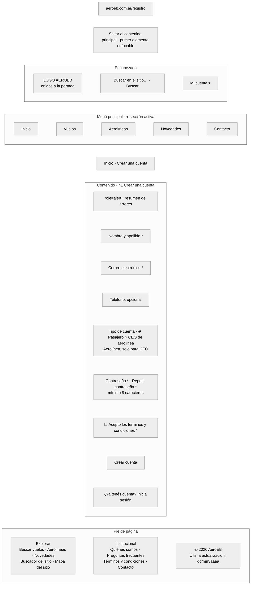

Imagen: [`png/wf-05-registro.png`](png/wf-05-registro.png)

## Figura 7a. Reserva, paso 2: asientos y promoción

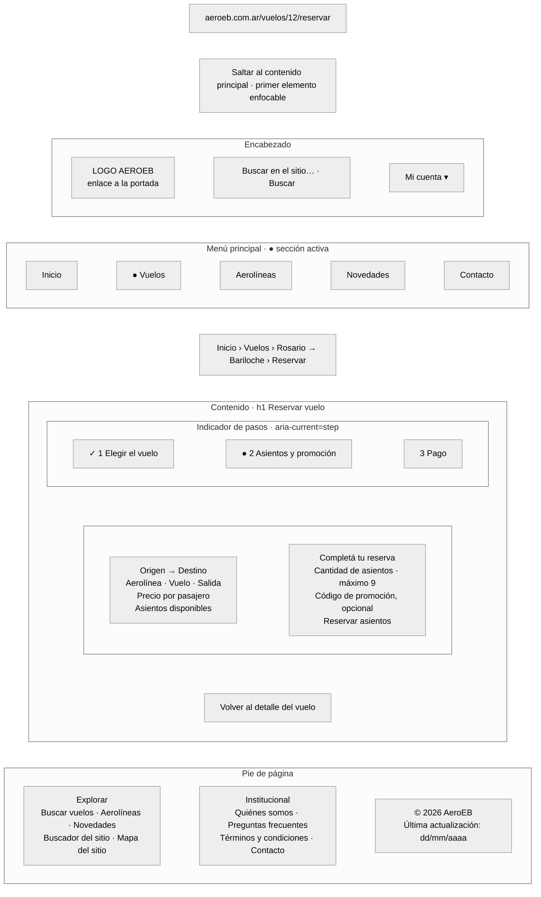

Imagen: [`png/wf-06-reserva.png`](png/wf-06-reserva.png)

## Figura 7b. Reserva, paso 3: pago simulado

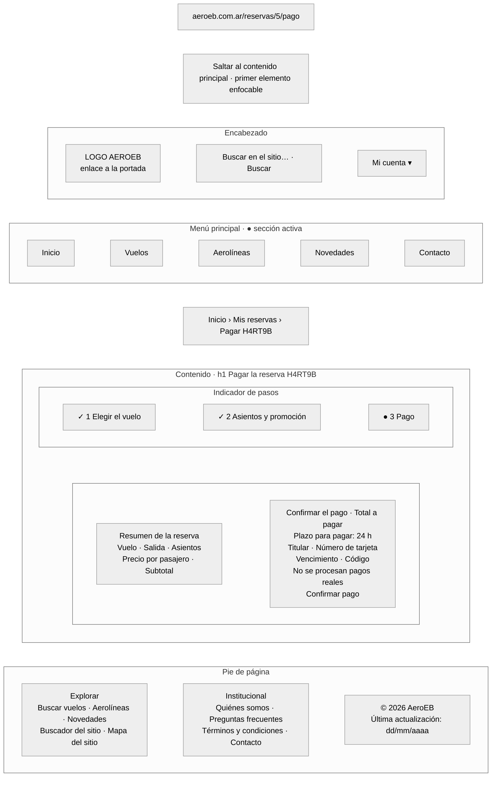

Imagen: [`png/wf-07-pago.png`](png/wf-07-pago.png)

## Figura 8. Mis reservas

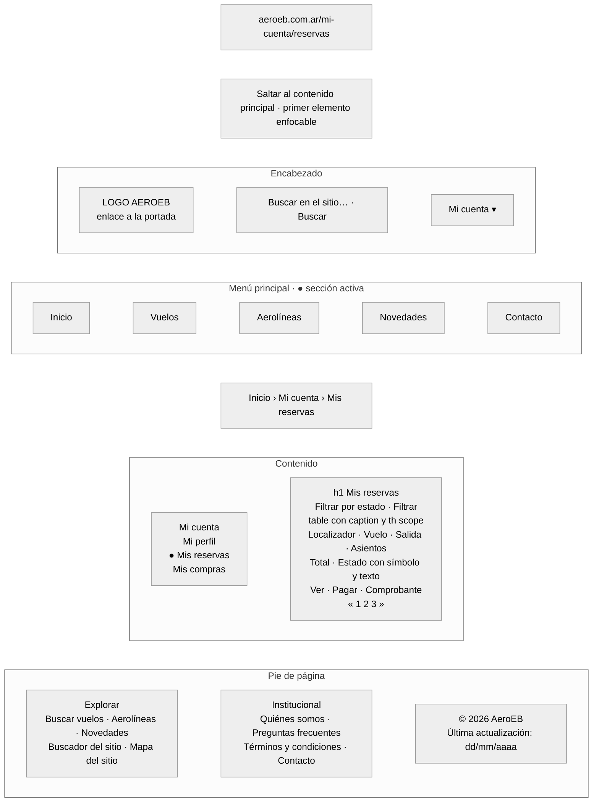

Imagen: [`png/wf-08-mis-reservas.png`](png/wf-08-mis-reservas.png)

## Figura 9. Tablero del CEO

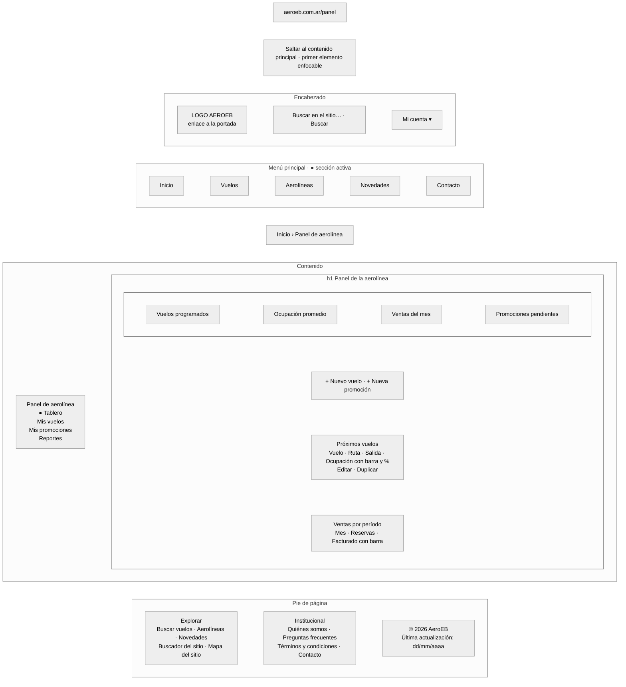

Imagen: [`png/wf-09-panel-ceo.png`](png/wf-09-panel-ceo.png)

## Figura 10. Tablero del administrador

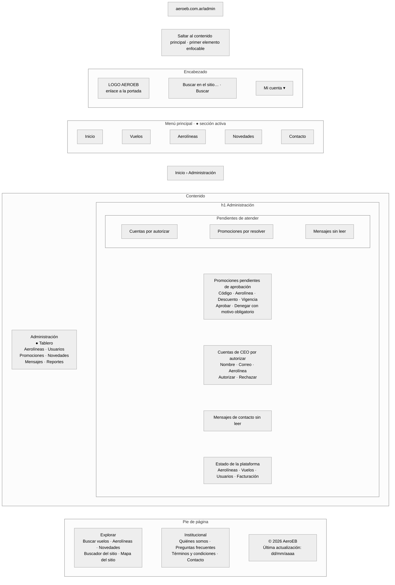

Imagen: [`png/wf-10-panel-admin.png`](png/wf-10-panel-admin.png)

## Figura 11. Contacto

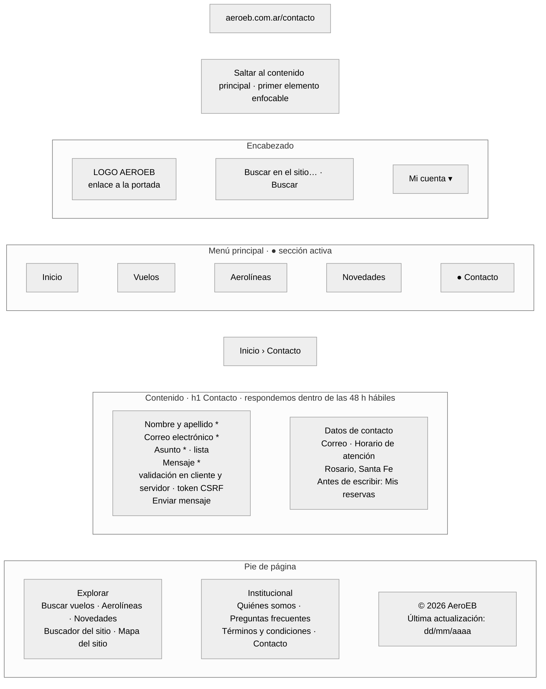

Imagen: [`png/wf-11-contacto.png`](png/wf-11-contacto.png)

## Figura 12. Mapa del sitio

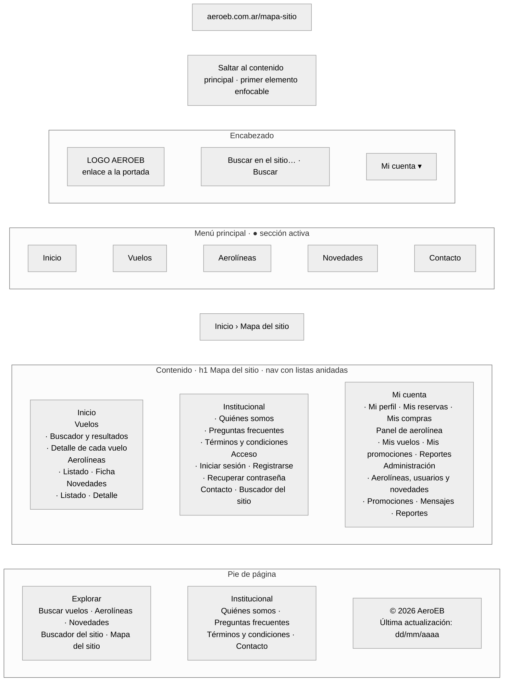

Imagen: [`png/wf-12-mapa-sitio.png`](png/wf-12-mapa-sitio.png)
