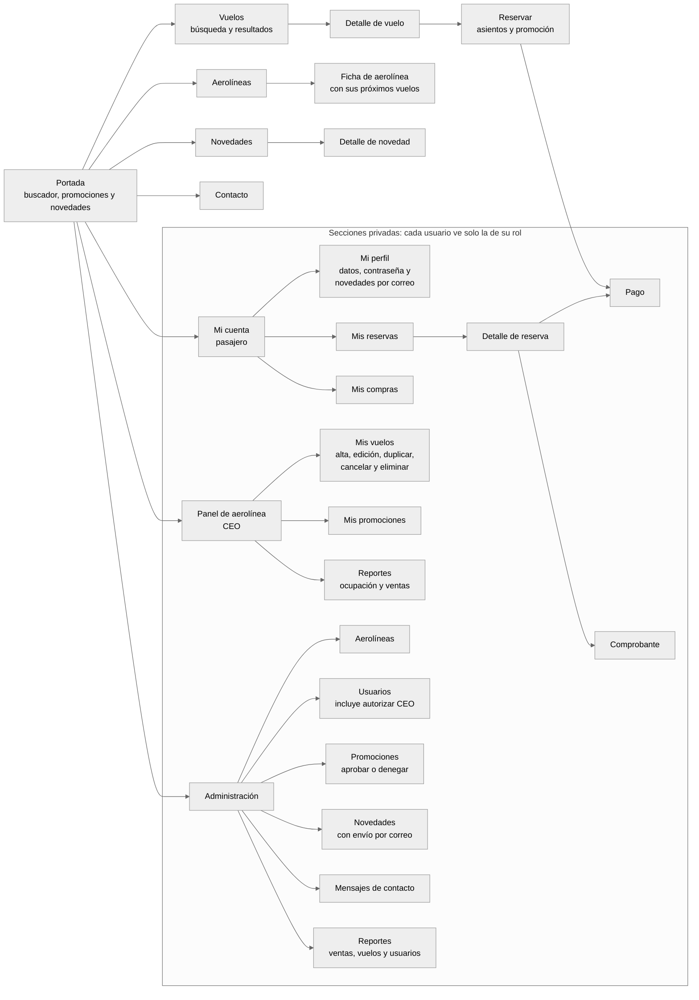

# Mapa del sitio: árbol de contenido funcional

Informe, punto 5.a. Las páginas se agrupan por la tarea que resuelve el usuario y no
por cómo está organizada la plataforma. Las secciones privadas solo se muestran al
rol que corresponde.

Corregido después de la exposición:

- **Mi cuenta** suma **Mis reservas** y **Mis compras**, que pide el enunciado y no estaban.
  "Boletín" y "Cambiar contraseña" dejan de ser páginas: son partes de Mi perfil.
- **Administración**: "Cuentas de CEO" y "Usuarios" eran la misma pantalla, y el
  "Boletín" no es una sección sino una opción al publicar una novedad.
- **Institucional** deja de ser una sección del menú principal: pasa al pie, porque no
  es una tarea del usuario. Se sacaron Privacidad y Accesibilidad.

Imagen: [`png/arbol-funcional.png`](png/arbol-funcional.png)

## Herramientas transversales

No son una rama del árbol: están en el encabezado o en el pie de **todas** las páginas,
así que se llega a ellas desde cualquier lugar.

- **Buscador del sitio** (encabezado): busca en vuelos, aerolíneas y novedades.
- **Ingresar, Registrarse y Recuperar contraseña** (menú "Mi cuenta ▾").
- **Mapa del sitio** (pie), que el enunciado pide que esté siempre en el footer.
- **Institucional** (pie): Quiénes somos, Preguntas frecuentes y Términos y condiciones.
