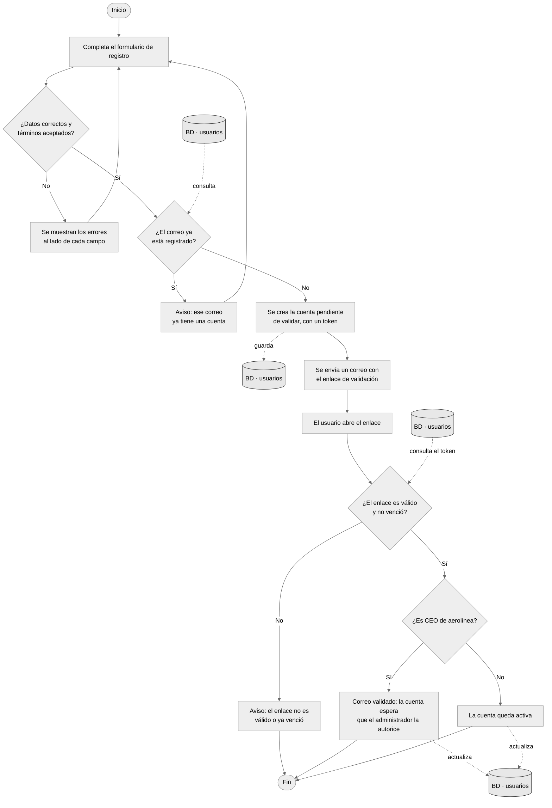
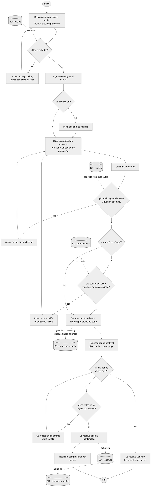
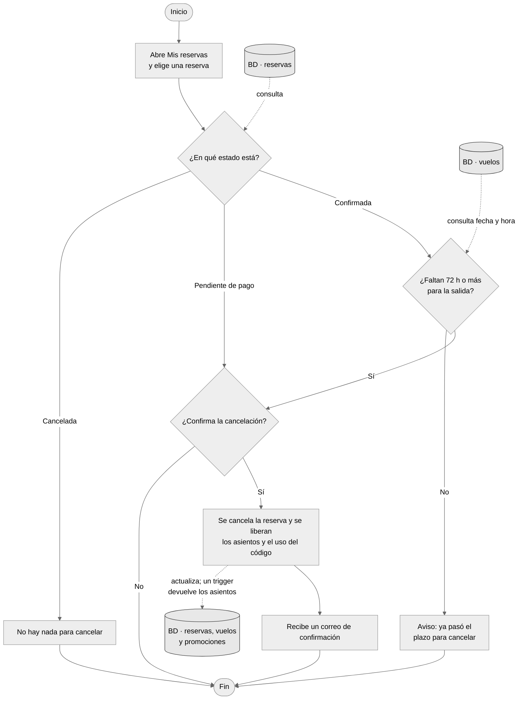
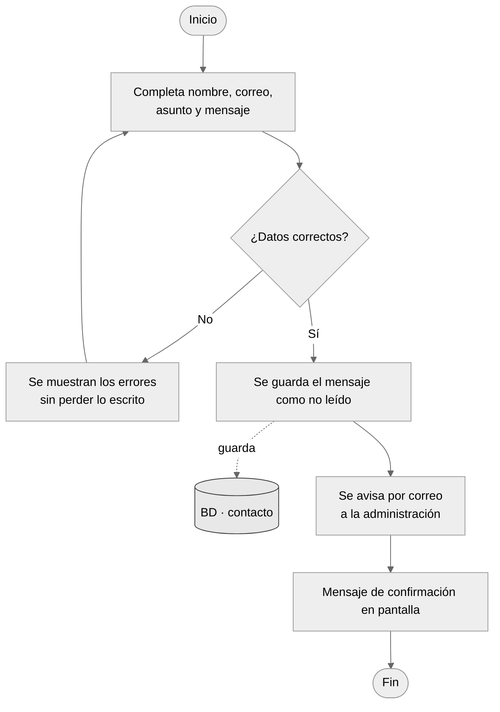

# Diagramas de flujo de las transacciones

Informe, punto 5.c. Los cuatro procesos que leen o escriben en la base de datos.

**Cómo leerlos:** el cilindro es la base de datos y la tabla que se usa. Las
flechas punteadas muestran qué paso la **consulta** (lectura) o la **guarda,
actualiza** (escritura). Las flechas llenas son el recorrido del usuario.

Corregido después de la exposición: se agregó la base de datos en cada consulta,
y se ajustaron los pasos a lo que hace el sitio (en la cancelación también se
puede cancelar una reserva pendiente de pago, y la reserva vence a las 24 h).

La imagen de cada diagrama, para pegar en el informe, está en [`png/`](png/).

## Flujo 1: Registro y validación de cuenta

Imagen: [`png/flujo-registro.png`](png/flujo-registro.png)

## Flujo 2: Búsqueda, reserva y pago

Imagen: [`png/flujo-reserva.png`](png/flujo-reserva.png)

## Flujo 3: Cancelación de una reserva

Imagen: [`png/flujo-cancelacion.png`](png/flujo-cancelacion.png)

## Flujo 4: Formulario de contacto

Imagen: [`png/flujo-contacto.png`](png/flujo-contacto.png)
