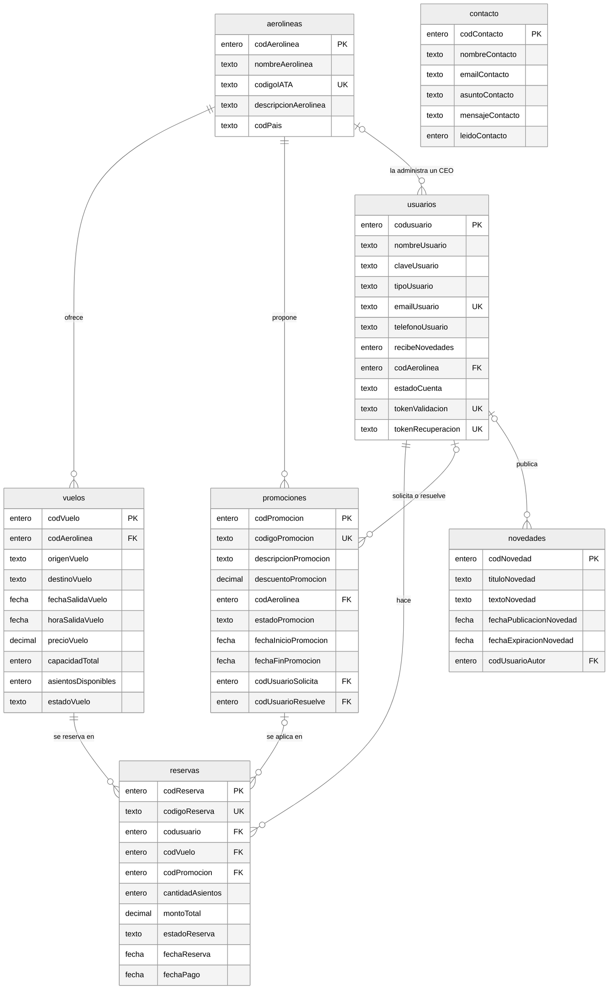
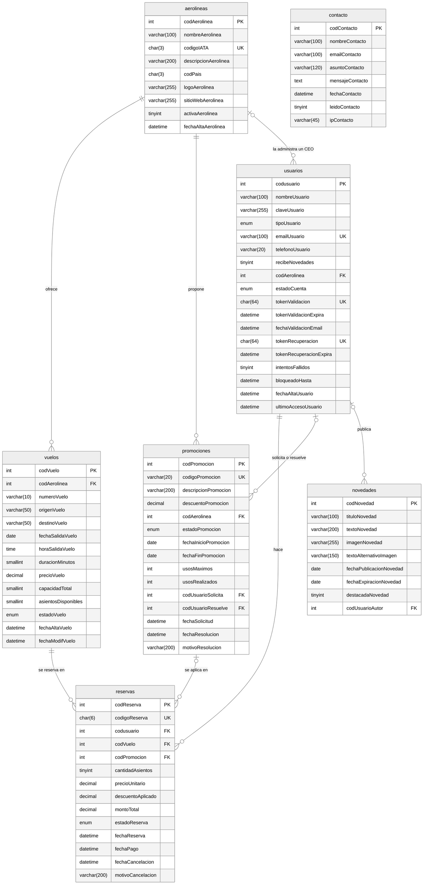

# Modelo de datos

Informe, punto 11. Base MySQL/MariaDB con motor InnoDB, integridad referencial declarativa
y juego de caracteres utf8mb4. El DDL completo está en [`scripts/schema.sql`](../../scripts/schema.sql);
el modelo físico de abajo se genera leyendo ese archivo, así que no puede diferir de la base real.

**Claves:** PK clave primaria (numérica, autoincremental y secuencial, como piden las reglas de
negocio 1, 2, 4, 7, 8 y 10), FK clave foránea, UK valor único.

## Modelo lógico

Entidades, relaciones y los atributos que pide el modelo mínimo del enunciado.

Imagen: [`png/modelo-logico.png`](png/modelo-logico.png)

## Modelo físico

Todas las columnas, con su tipo real en MySQL/MariaDB.

Imagen: [`png/modelo-fisico.png`](png/modelo-fisico.png)

## Además de las tablas

- **Vistas** `v_ocupacion_vuelos` y `v_ventas_mensuales`: alimentan los reportes del CEO y del administrador.
- **Trigger** `trg_reservas_cancelacion`: al cancelar una reserva devuelve los asientos al vuelo.
- **Restricciones CHECK**: precio positivo, asientos disponibles nunca mayores a la capacidad,
  origen distinto del destino, descuento entre 0 y 100, vigencia de promociones y novedades
  coherente, entre 1 y 9 asientos por reserva, y un CEO siempre asociado a una aerolínea.
- **Índices** para la búsqueda de vuelos (origen, destino, fecha y estado), los listados por
  usuario y por vuelo, y la vigencia de promociones y novedades.
