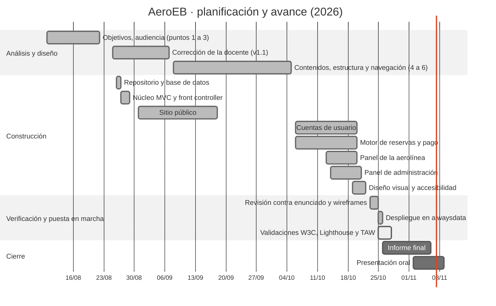

# Planificación del trabajo

Informe, punto 8. Las fechas de fin de las tareas terminadas salen del historial de commits
del repositorio y de las versiones del informe (22/08, 07/09 y 05/10); las de inicio son
estimadas. Las tareas del cierre están planificadas.

Imagen: [`png/gantt.png`](png/gantt.png)
